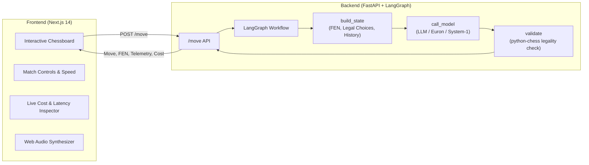

# CogniChess Arena ♟️🤖

> **Dual-Process AI Chess Arena: Benchmarking Frontier LLMs vs. System-1 Intuition Engines**

[](https://fastapi.tiangolo.com/)
[](https://github.com/langchain-ai/langgraph)
[](https://nextjs.org/)
[](https://www.python.org/)
[](https://opensource.org/licenses/MIT)

---

## 📌 Overview

**CogniChess Arena** is an experimental evaluation platform designed to pit **frontier reasoning models** (Flagship LLMs including OpenAI GPT-6 Luna, GPT-6.1 Sol, GPT-6 Sol, GPT-6 Astra, GPT-5.5, Anthropic Claude Sonnet 5.5, Claude Opus 5.5, and Claude Fable 5.1) against each other and against **System-1 reflexive neural or heuristic models** on the chessboard.

Built with **FastAPI**, **LangGraph**, and **Next.js 14**, this arena provides real-time chess visualization, telemetry tracking (latency, token consumption, fallback rates, and exact match costs in USD), and audio feedback via Web Audio API.

---

## ✨ Features

- ⚡ **Dual-Process AI Framework**: Compare high-latency deliberative LLMs with ultra-fast intuitive System-1 policies.
- 🔄 **LangGraph Decision Pipeline**: Reliable multi-step workflow (`build_state` ➔ `call_model` ➔ `validate`).
- 🛡️ **Autonomous Fallback System**: Strict UCI move validation using `python-chess`. Automatically detects and handles illegal or malformed model responses with flagged legal fallbacks.
- 📊 **Real-Time Telemetry & Inspector**:
  - Live cost tracking (USD per move and cumulative).
  - Token usage breakdown (Prompt vs. Completion tokens).
  - Inference latency monitoring (milliseconds per move).
  - Full prompt inspection & raw model response preview.
- 🎮 **Modern Interactive UI**:
  - Polished dark-mode chess interface.
  - Interactive board with piece highlights and move indicators.
  - Captured pieces tally and algebraic notation move history.
  - Adjustable match speed (100ms - 2000ms delay) and step-by-step move mode.
  - Native Web Audio synthesized sounds for moves, captures, and checks (zero external audio files).
- 🌐 **Frontier Next-Gen Model Coverage**:
  - **System-1 Intuition Policy**: **Jev** (Built-in 1-ply tactical evaluator or custom external CLM/Jev endpoint).
  - **OpenAI Flagship**: GPT-6 Luna, GPT-6.1 Sol, GPT-6 Sol, GPT-6 Astra, GPT-5.5
  - **Anthropic Flagship & Fable**: Claude Sonnet 5.5, Claude Opus 5.5, Claude Fable 5.1, Claude Opus 5, Claude Sonnet 5, Claude Fable 5, Claude Opus 4.8

| Model | Provider | Model ID |
|---|---|---|
| **Jev** | System-1 | `system1` |
| **GPT-6 Luna** | OpenAI | `gpt-6-luna` |
| **GPT-6.1 Sol** | OpenAI | `gpt-6.1-sol` |
| **GPT-6 Sol** | OpenAI | `gpt-6-sol` |
| **GPT-6 Astra** | OpenAI | `gpt-6-astra` |
| **GPT-5.5** | OpenAI | `gpt-5.5` |
| **Claude Sonnet 5.5** | Anthropic | `claude-sonnet-5-5` |
| **Claude Opus 5.5** | Anthropic | `claude-opus-5-5` |
| **Claude Fable 5.1** | Anthropic | `claude-fable-5-1` |
| **Claude Opus 5** | Anthropic | `claude-opus-5` |
| **Claude Sonnet 5** | Anthropic | `claude-sonnet-5` |
| **Claude Fable 5** | Anthropic | `anthropic/claude-fable-5` |
| **Claude Opus 4.8** | Anthropic | `anthropic/claude-opus-4-8` |

---

## 🏗️ Architecture



---

## 📁 Repository Structure

```text
cognichess-arena/
├── backend/
│   ├── main.py              # FastAPI server, LangGraph engine, and model routing
│   └── requirements.txt     # Python dependencies (fastapi, langgraph, chess, httpx)
├── frontend/
│   ├── app/
│   │   ├── globals.css      # Custom styles and responsive layouts
│   │   ├── layout.js        # Root layout and metadata
│   │   └── page.js          # Interactive arena dashboard & audio synthesizer
│   ├── public/              # Chess piece assets
│   └── package.json         # Next.js 14 and React dependencies
├── .env.example             # Template for API keys
├── .gitignore               # Excludes secrets, venvs, and build caches
├── CLAUDE.md                # System contract and prompt guidelines
└── README.md                # Project documentation
```

---

## 🚀 Getting Started

### Prerequisites

- **Python**: 3.10 or later
- **Node.js**: 18.x or later (tested on v22)
- **Git**

---

### 1. Clone & Setup Environment

```bash
git clone https://github.com/Ashishds/cognichess-arena.git
cd cognichess-arena

# Copy environment template
cp .env.example .env
```

Edit `.env` with your API keys (only configure the providers you plan to benchmark):

```env
OPENAI_API_KEY=your_key_here
ANTHROPIC_API_KEY=your_key_here
EURON_API_KEY=your_euron_key_here
SYSTEM1_URL=       # Leave blank to use built-in simulated policy
SYSTEM1_API_KEY=
```

---

### 2. Backend Setup

```bash
cd backend

# Create and activate virtual environment
python -m venv .venv

# On Linux/macOS:
source .venv/bin/activate
# On Windows (PowerShell):
.\.venv\Scripts\Activate.ps1

# Install dependencies
pip install -r requirements.txt

# Start FastAPI server
uvicorn main:app --reload --port 8000
```

Backend API will be accessible at: `http://localhost:8000` (docs at `http://localhost:8000/docs`).

---

### 3. Frontend Setup

In a new terminal:

```bash
cd frontend

# Install dependencies
npm install

# Start Next.js development server
npm run dev
```

Open [http://localhost:3000](http://localhost:3000) in your browser.

---

## ⚙️ Configuration & Custom Models

You can easily register new models and configure pricing per 1M tokens by editing `MODELS` in [backend/main.py](file:///g:/chess-arena/backend/main.py):

```python
MODELS = {
    # id -> (label, provider, api model name, $/1M input, $/1M output)
    "gpt-6-luna": ("OpenAI GPT-6 Luna", "openai", "gpt-6-luna", 0.10, 0.50),
    "claude-sonnet-5-5": ("Anthropic Claude Sonnet 5.5", "anthropic", "claude-sonnet-5-5", 2.0, 10.0),
}
```

---

## 🤝 Contributing

Contributions, issues, and feature requests are welcome! Feel free to check the issues page or submit a pull request.

---

## 📄 License

Distributed under the [MIT](file:///g:/chess-arena/LICENSE) License.
